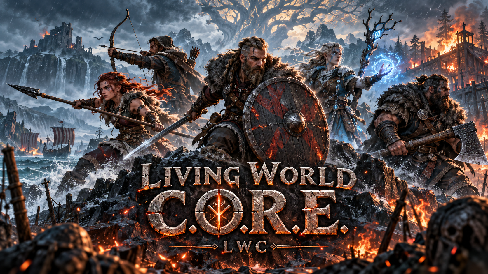
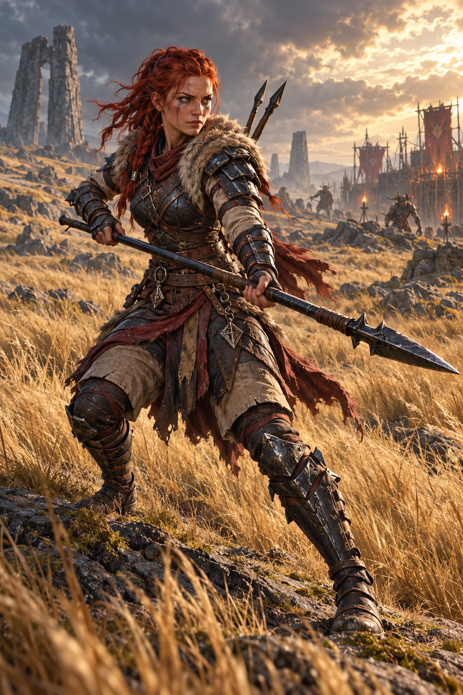

# Living World C.O.R.E.: story and world guide

This is the public narrative entrance to **Living World C.O.R.E.** It explains
what kind of world the project is building without requiring the reader to begin
with code, test reports, or implementation history.

> Odin knew deeds, deaths, victories, and usefulness. He did not know every heart.

## The world before you

The player is not the first person to awaken in Valheim.

Earlier dead arrived from Midgard, received embodied life again, and tried to make
homes in the forgotten land. They raised halls, fenced fields, cut roads, buried
friends, traded across biomes, fought the Forsaken, and sometimes fought one
another. Their settlements explain why the world can feel inhabited before the
player finds a living camp.

Living World calls this embodied return the **Second Breath**. These people are
not transparent ghosts. They hunger, tire, bleed, sleep, work, love, and die.
Their second life is real enough to matter.

## The fracture

Odin gathered useful dead for the wars of Valheim. Some accepted his purpose.
Some served only long enough to survive. Others refused to trade one lord's
commands for another's.

They wanted hearth, kin, work, and peace. Valheim would not permit peace without
defense, so they learned to fight for one another rather than merely for Odin's
contest.

Wandering people without a secure home are often called **Hearthless**. Those who
join or establish a defended home become **Hearthbound**. These are conditions,
not races, moral alignments, or permanent factions.

## Why the villages fell

The ruined draugr villages are not recruitment pens filled with villagers waiting
to be restored. Their draugr are embodied revenants held by possession, broken
obligation, corruption, or the violence that destroyed the settlement.

Defeating them releases the bound dead from corrupted flesh. It does not turn the
same corpse into a new companion. Reclamation makes the hearth safe enough for
living Second-Breath survivors—from camps, refuges, roads, and wandering
bands—to return.

## The people still living

Friendly, neutral, hostile, corrupted, freed, and unaffiliated people use the same
core idea: morality is not assigned by body, sex, people, or biome.

Travellers can find:

- wary camps reading the player's intentions;
- scouts watching roads and creature routes;
- survivors repairing, cooking, hunting, mourning, or tending wounds;
- Pillagers who chose predation over rebuilding;
- regional people such as Rimebound and Emberworn whose allegiance is individual;
- ancient Forest Guardians whose hostility depends on stewardship and violation;
- Eitrherjar Legionaries, corrupted battle-dead whose dead war has outlived every
  living commander.

A person first met in the wilderness may later become a companion, guard, worker,
resident, specialist, or village leader without being replaced by a new NPC.

## Discovery rather than purchase

Huginn teaches that other people exist and that signs of habitation can be read.
He does not provide a catalogue.

Smoke, worked stumps, butchered game, footprints, warding marks, distant calls,
and brief signals lead the player toward encounters. A camp has a place,
activity, pressure, allegiance, and reason to remain or move.

Recruitment has no hidden affection roll. After the encounter establishes what
the person knows, the player asks:

> Will you come with me?

The answer is yes or no. Personality shapes the words, not a concealed reroll.
Yes is not ownership. No is not punishment.

## Meet many, travel with few

The world may contain many persistent people, but the default expedition party is
two companions. One active slot opens after Eikthyr and the second after the
Elder. The wider bonded roster holds six living companions by default.

Later bosses unlock believable encounter tiers, equipment, roles, and regions—not
an unlimited army. A companion released from the expedition returns to meaningful
life at a home, camp, reclaimed village, guard post, or workplace. They do not
vanish to free a menu slot.

## Formidable, not disposable

Companions are intended to feel akin to players: they traverse the same world,
carry coherent equipment, use real combat constraints, react to danger, and keep
their identity across roles.

They must be formidable without playing the entire game for the player. Two
companions should not reliably defeat a same-tier boss or full raid while the
player remains passive.

The Second Breath is given once. Once a legitimate companion's death is
authoritatively committed, there is no **Third Breath**. Their gear may be
recovered and their deeds remembered, but reload, recall, bed, cleric, portal, or
console cannot restore that person.

Permanent mortality remains disabled until traversal, hazards, network ownership,
and death attribution are proven safe.

## The player's question

Odin asks the player to prove worth by defeating the Forsaken. Living World adds
another question:

> What does your strength serve?

The player can free bound dead, defend people who say yes, respect those who say
no, restore roads and hearths, and build a coalition without becoming another
owner of human lives.

The story is not that Odin is secretly simple or foolish. It is that even a god
gathering heroes for a necessary war may mistake usefulness for consent.

## Visual development

The current key art establishes the project's ensemble, biome-spanning and
formidable tone.

The Plains spear huntress is a presentation target for a fast, mobile specialist,
not proof of a finished in-game model. Runtime assets, rigging, animation,
networking, equipment fit, and combat still require evidence.

## Continue reading

- [The Second Breath lore bible](LORE-BIBLE-THE-SECOND-BREATH.md)
- [Faction and peoples bible](FACTION-AND-PEOPLES-BIBLE.md)
- [World discovery and biome roles](WORLD-COMPANION-DISCOVERY-AND-BIOME-ROLES.md)
- [Companion progression, roster, and release](COMPANION-PROGRESSION-ROSTER-AND-RELEASE.md)
- [Encounter personality and dialogue](../LivingWorldCompanionSystems/ENCOUNTER-PERSONALITY-AND-DIALOGUE.md)
- [Visual-development gallery](../art/README.md)
- [Living World chronicle](../docs/LIVING-WORLD-CHRONICLE.md)

The lore bibles define canon. This guide is the readable entrance and must be
updated whenever a binding story decision changes the world described here.
